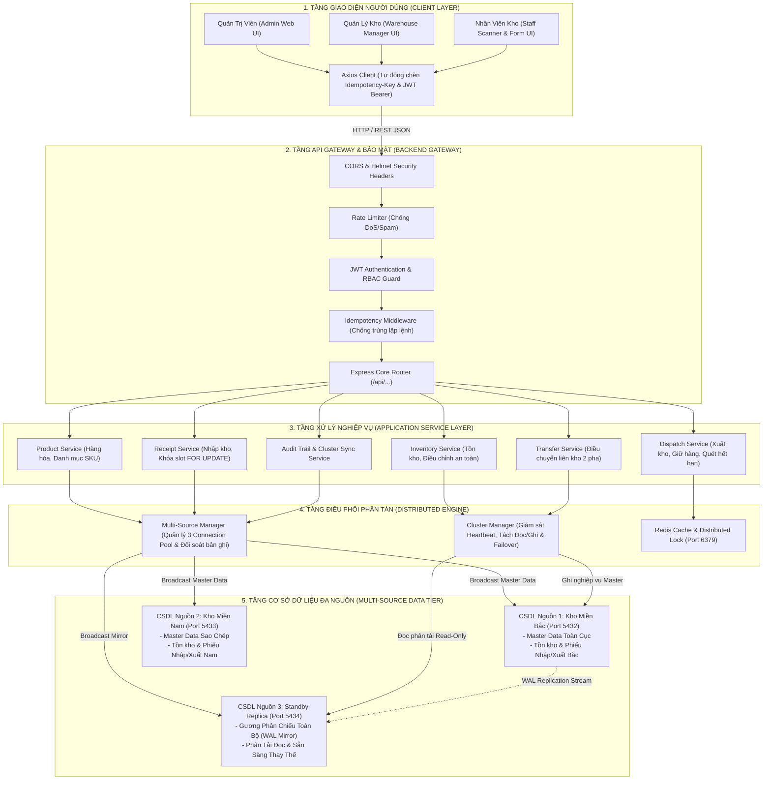
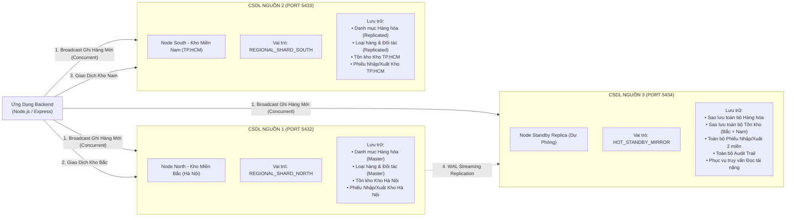
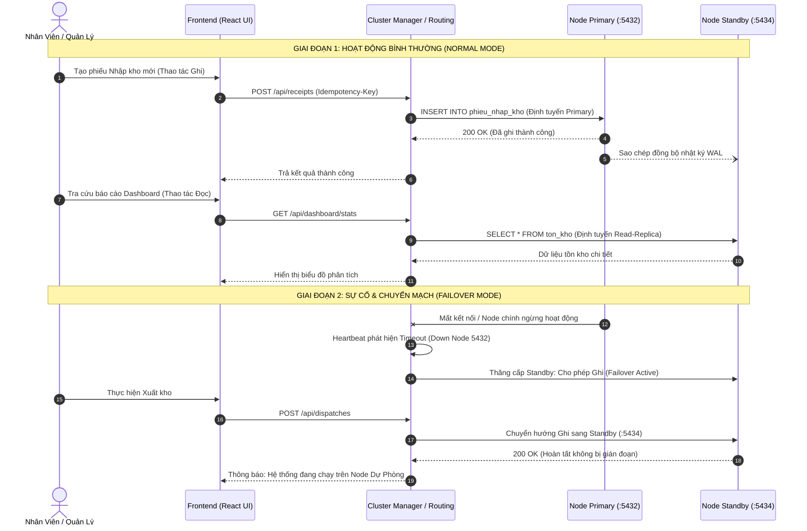
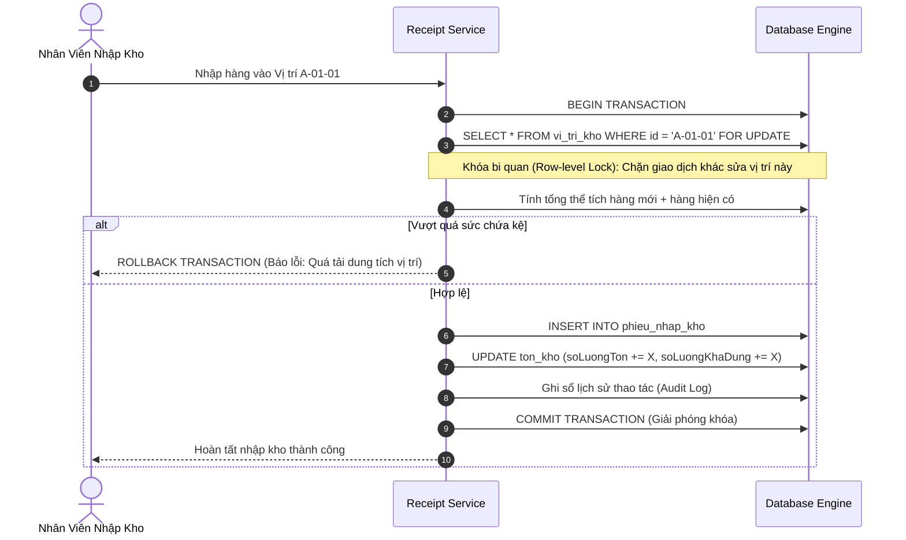
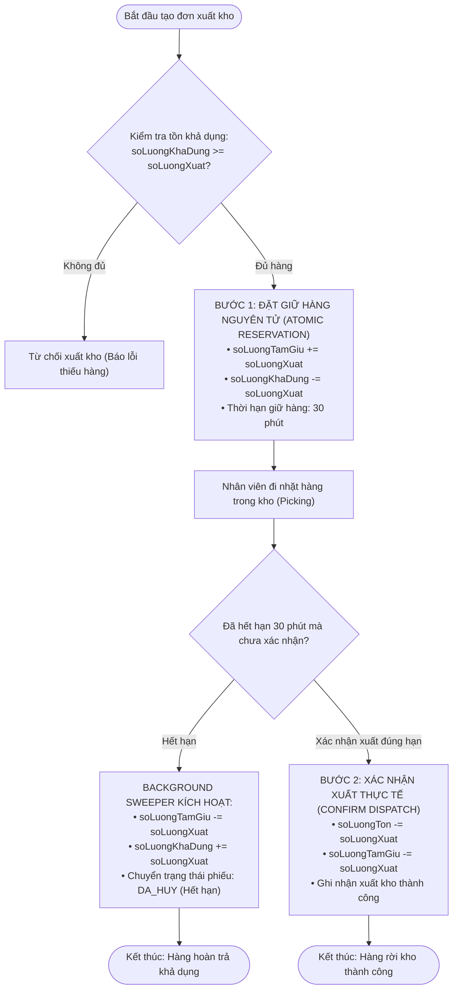
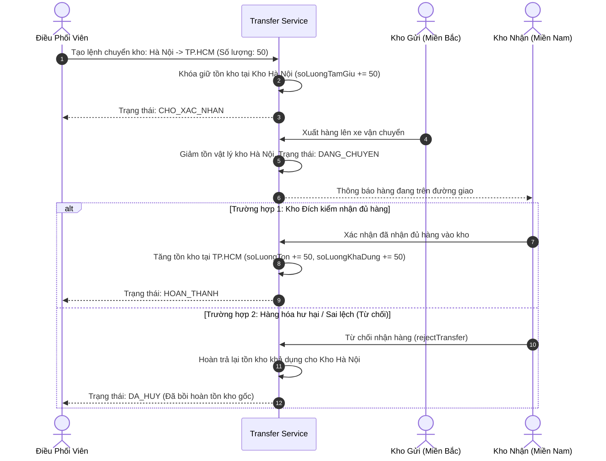
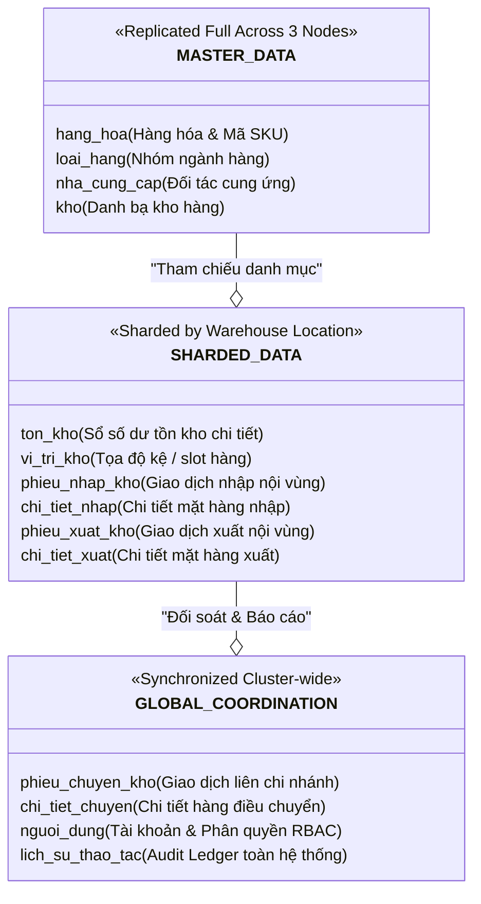

# SƠ ĐỒ TOÀN BỘ HỆ THỐNG QUẢN LÝ KHO HÀNG PHÂN TÁN (WMS)
> **Dự án**: Hệ Thống Quản Lý Kho Hàng Phân Tán (WMS - Warehouse Management System) - Nhóm 8  
> **Kiến trúc**: Micro-Cluster & Multi-Source Distributed Database (Primary-Standby & Multi-Regional Sharding)  
> **Ngày cập nhật**: 23/11/2026  

---

## 📑 MỤC LỤC
1. [Sơ Đồ Kiến Trúc Tổng Thể Hệ Thống (High-Level Architecture)](#1-sơ-đồ-kiến-trúc-tổng-thể-hệ-thống-high-level-architecture)
2. [Sơ Đồ Cụm Cơ Sở Dữ Liệu Đa Nguồn (Multi-Source Database Cluster)](#2-sơ-đồ-cụm-cơ-sở-dữ-liệu-đa-nguồn-multi-source-database-cluster)
3. [Sơ Đồ Phân Luồng Đọc / Ghi & Chuyển Mạch Sự Cố (Read/Write Routing & Failover)](#3-sơ-đồ-phân-luồng-đọc--ghi--chuyển-mạch-sự-cố-readwrite-routing--failover)
4. [Sơ Đồ Luồng Nghiệp Vụ Kho Phân Tán (Distributed Business Workflows)](#4-sơ-đồ-luồng-nghiệp-vụ-kho-phân-tán-distributed-business-workflows)
   - [4.1. Luồng Nhập Kho & Khóa Vị Trí (Inbound & Concurrency Locking)](#41-luồng-nhập-kho--khóa-vị-trí-inbound--concurrency-locking)
   - [4.2. Luồng Xuất Kho & Giữ Hàng Tạm Thời (Outbound & Two-Phase Reservation)](#42-luồng-xuất-kho--giữ-hàng-tạm-thời-outbound--two-phase-reservation)
   - [4.3. Luồng Điều Chuyển Liên Kho (Inter-Warehouse Transfer)](#43-luồng-điều-chuyển-liên-kho-inter-warehouse-transfer)
5. [Sơ Đồ Ánh Xạ Thực Thể & Phân Bổ Bảng Dữ Liệu (Distributed Data Mapping)](#5-sơ-đồ-ánh-xạ-thực-thể--phân-bổ-bảng-dữ-liệu-distributed-data-mapping)
6. [Sơ Đồ Cổng Dịch Vụ & Mạng Hạ Tầng Docker (Infrastructure & Network Topology)](#6-sơ-đồ-cổng-dịch-vụ--mạng-hạ-tầng-docker-infrastructure--network-topology)

---

## 1. Sơ Đồ Kiến Trúc Tổng Thể Hệ Thống (High-Level Architecture)



---

## 2. Sơ Đồ Cụm Cơ Sở Dữ Liệu Đa Nguồn (Multi-Source Database Cluster)

Hệ thống áp dụng mô hình lai (**Hybrid Distributed Architecture**):
- **Master Data (Dữ liệu chung)**: Ghi phát tán đồng thời (Broadcast Write) sang cả 3 nguồn.
- **Operational Data (Dữ liệu vận hành)**: Phân mảnh theo kho địa lý (Sharding by Warehouse ID) vào Node tương ứng nhằm giảm tải I/O.
- **Hot Standby Mirror (Sao lưu dự phòng)**: Đồng bộ hóa toàn bộ hai miền về Nguồn 3 để đảm bảo khả năng sẵn sàng cao (High Availability).



---

## 3. Sơ Đồ Phân Luồng Đọc / Ghi & Chuyển Mạch Sự Cố (Read/Write Routing & Failover)

Cơ chế điều phối truy vấn thông minh của `ClusterManager`:
1. **Lệnh Ghi (Write Queries: `INSERT`, `UPDATE`, `DELETE`)**: Luôn đi vào **Primary Master (Port 5432)** để đảm bảo tính toàn vẹn giao dịch (ACID).
2. **Lệnh Đọc (Read Queries: `SELECT`)**: Các báo cáo tổng hợp, tìm kiếm danh mục được điều hướng sang **Standby Replica (Port 5434)** để giải phóng tải CPU/RAM cho Master.
3. **Chuyển Mạch Sự Cố (Automatic / Simulated Failover)**: Khi Node 5432 gặp sự cố, hệ thống tự động thăng cấp Standby 5434 thành Primary để duy trì hoạt động không gián đoạn.



---

## 4. Sơ Đồ Luồng Nghiệp Vụ Kho Phân Tán (Distributed Business Workflows)

### 4.1. Luồng Nhập Kho & Khóa Vị Trí (Inbound & Concurrency Locking)
Bảo đảm hai phiếu nhập đồng thời vào cùng một kệ không vượt quá dung tích chứa tối đa (`sucChuaToiDa`).



---

### 4.2. Luồng Xuất Kho & Giữ Hàng Tạm Thời (Outbound & Two-Phase Reservation)
Giải quyết bài toán tương tranh (Race Condition): Hàng không bị bán âm và tự động giải phóng nếu nhân viên không thực xuất trước thời hạn.



---

### 4.3. Luồng Điều Chuyển Liên Kho (Inter-Warehouse Transfer)
Quy trình điều phối hàng hóa giữa Kho Miền Bắc (5432) và Kho Miền Nam (5433).



---

## 5. Sơ Đồ Ánh Xạ Thực Thể & Phân Bổ Bảng Dữ Liệu (Distributed Data Mapping)



---

## 6. Sơ Đồ Cổng Dịch Vụ & Mạng Hạ Tầng Docker (Infrastructure & Network Topology)

```mermaid
graph TD
    subgraph DOCKER_COMPOSE["CỤM HẠ TẦNG DOCKER (DOCKER VIRTUAL NETWORK: 172.28.0.0/16)"]
        subgraph APPS["CONTAINERS DỊCH VỤ ỨNG DỤNG"]
            FE_CONTAINER["frontend-ui\n(Vite + React)\nHost Port: 5173\nInternal: 5173"]
            BE_CONTAINER["backend-api\n(Express + Node)\nHost Port: 5000\nInternal: 5000"]
            REDIS_CONTAINER["redis-cluster\n(Distributed Cache)\nHost Port: 6379\nInternal: 6379"]
        end

        subgraph DBS["CONTAINERS CƠ SỞ DỮ LIỆU ĐA NGUỒN"]
            DB_NORTH_C["postgres (Node North)\nPostgreSQL 15 Alpine\nHost Port: 5432\nVolume: pgdata_north"]
            DB_SOUTH_C["postgres-south (Node South)\nPostgreSQL 15 Alpine\nHost Port: 5433\nVolume: pgdata_south"]
            DB_REPLICA_C["postgres-replica (Standby Mirror)\nPostgreSQL 15 Alpine\nHost Port: 5434\nVolume: pgdata_replica"]
        end

        FE_CONTAINER -->|API Calls (Proxy)| BE_CONTAINER
        BE_CONTAINER -->|Lock & Session| REDIS_CONTAINER
        BE_CONTAINER -->|Primary / North Shard Connection| DB_NORTH_C
        BE_CONTAINER -->|South Shard Connection| DB_SOUTH_C
        BE_CONTAINER -->|Read-Replica & Mirror Connection| DB_REPLICA_C
        DB_NORTH_C -.->|Async Replication Stream| DB_REPLICA_C
    end

    CLIENT_BROWSER["Trình duyệt Client\n(http://localhost:5173)"] --> FE_CONTAINER
    API_CONSUMER["Client API / Postman\n(http://localhost:5000/api)"] --> BE_CONTAINER
```

---

## 7. Tổng Hợp Các Điểm Nhấn Kiến Trúc Thuyết Trình
1. **Tính Toàn Vẹn & Không Bị Ghi Đè (ACID + Idempotency)**:
   - Client tự động sinh mã `Idempotency-Key` (UUIDv4) gắn vào header mọi request POST/PUT/DELETE.
   - Khi mạng lag hoặc nhân viên bấm nút nhiều lần, server chỉ xử lý đúng 1 lần duy nhất.
2. **Khóa Hàng Tránh Bán Âm (Two-Phase Inventory Lock)**:
   - Sử dụng công thức bất biến: `soLuongKhaDung = Math.max(0, soLuongTon - soLuongTamGiu)`.
   - Có tiến trình `sweep-expired` dọn dẹp phiếu quá hạn mỗi 5 phút.
3. **Phân Luồng Đọc/Ghi & Chống Nghẽn Cổ Chai (Read/Write Splitting)**:
   - Thao tác thay đổi số dư -> Master (5432).
   - Thao tác xuất biểu đồ/báo cáo -> Replica (5434).
4. **Lưu Trữ Đa Nguồn & Phân Mảnh Dữ Liệu (Multi-Source Sharding)**:
   - Các kho độc lập xử lý giao dịch cục bộ không ảnh hưởng đến nhau.
   - Master data đồng bộ toàn hệ thống.
5. **Chuyển Mạch Tự Động Khi Sự Cố (High Availability & Failover)**:
   - Standby Replica sẵn sàng thăng cấp thành Master khi phát hiện Node chính ngừng hoạt động.
